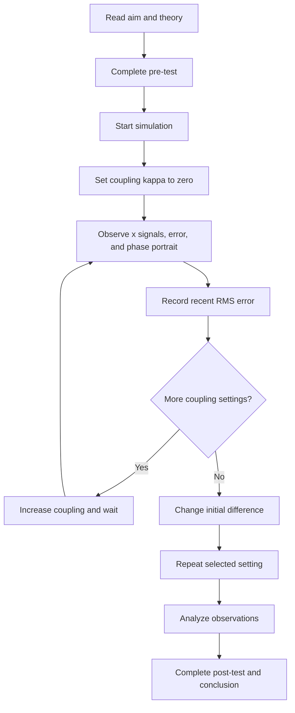

### Experiment flow

The simulator runs two Rössler systems with a fixed fourth-order Runge–Kutta step. Changing the initial-difference control resets both systems; changing coupling applies the new value to the continuing state.
